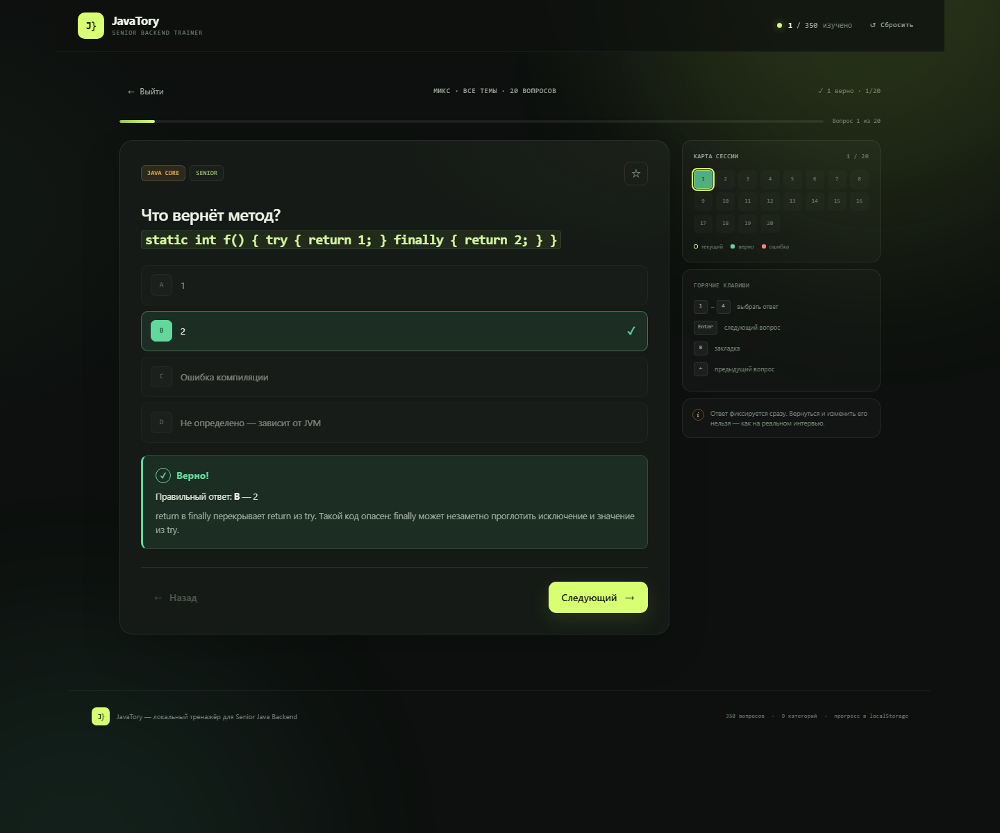
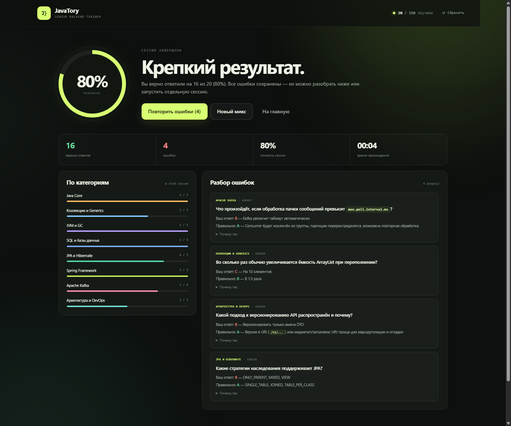
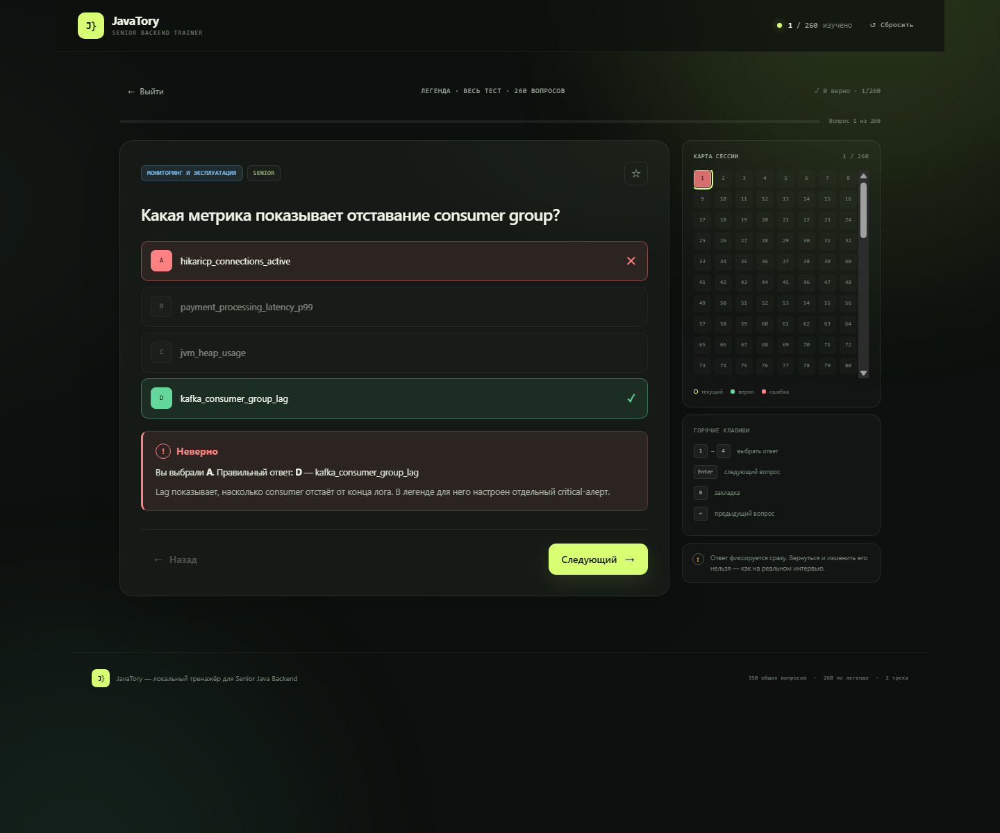
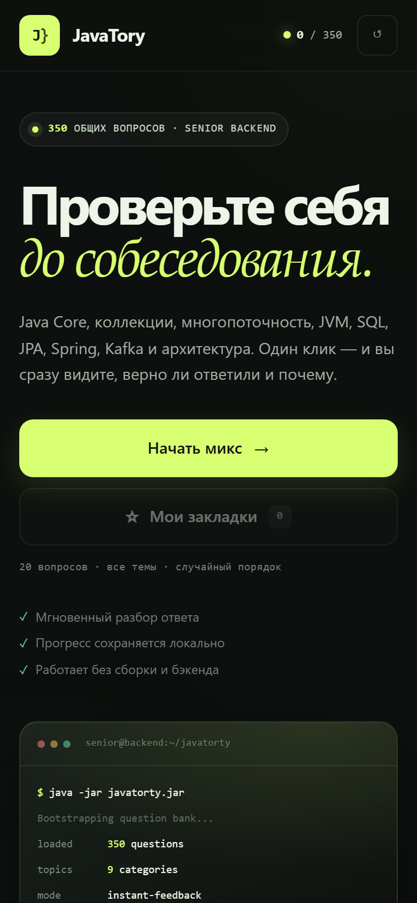
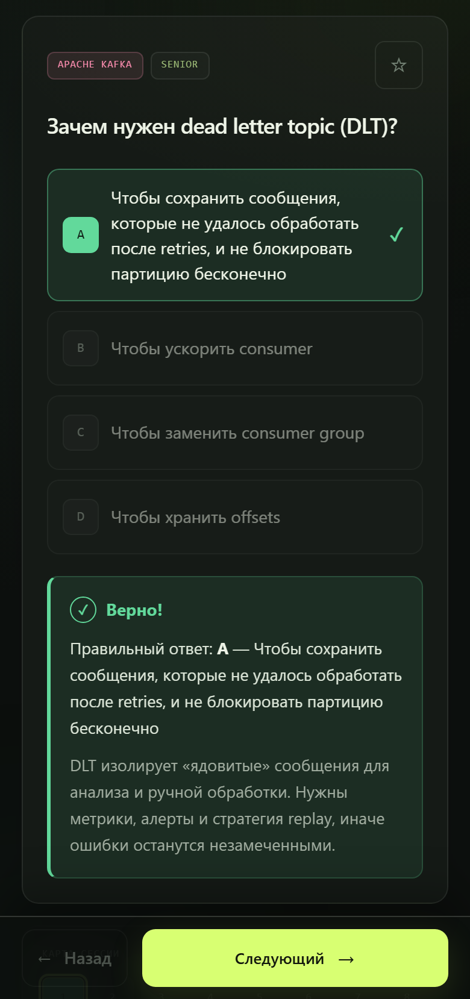
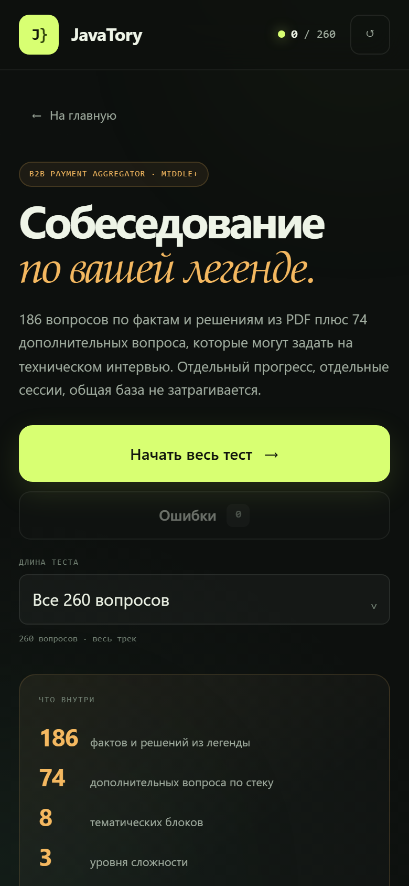

# JavaTory

Локальный тренажёр для подготовки к собеседованию на **Senior Java Backend**.
Внутри **610 вопросов в двух независимых треках**:

- **350 общих вопросов** по Java Core, коллекциям, многопоточности, JVM, SQL, JPA/Hibernate, Spring, Kafka и архитектуре;
- **260 вопросов по технической легенде** B2B Payment Aggregator: 186 фактов и решений из PDF + 74 дополнительных вопроса, которые могут задать на интервью.

После выбора варианта сразу видно, верно ли вы ответили, какой ответ правильный и почему.

**Открыть на телефоне:** https://daniil2022ri.github.io/JavaTory/


Сайт полностью статический: без сборки, npm-зависимостей, бэкенда и базы данных.
Достаточно открыть папку в VS Code и запустить **Live Server**.

## Скриншоты

### Вопрос и мгновенная проверка



### Итоги сессии и разбор ошибок



### Отдельный трек по технической легенде




## Быстрый старт в VS Code

1. Скачайте репозиторий или клонируйте его:
   ```bash
   git clone https://github.com/Daniil2022Ri/JavaTory.git
   cd JavaTory
   ```
2. Откройте папку `JavaTory` в VS Code: **File → Open Folder**.
3. Установите расширение [Live Server](https://marketplace.visualstudio.com/items?itemName=ritwickdey.LiveServer) (Ritwick Dey), если оно ещё не установлено. Оно указано в рекомендациях проекта, поэтому VS Code предложит его установить.
4. В Explorer нажмите правой кнопкой на `index.html` → **Open with Live Server**.
5. Браузер откроет приложение, обычно по адресу `http://127.0.0.1:5500/index.html`.

Дополнительных команд запуска нет. Live Server сам раздаёт HTML, CSS и JavaScript.

<details>
<summary>Альтернативные способы запуска</summary>

Любой статический HTTP-сервер подойдёт, например:

```bash
# Python 3
python -m http.server 5500

# или Node.js
npx serve .
```

После этого откройте `http://localhost:5500`.

Можно открыть `index.html` и двойным кликом: приложение не использует `fetch` и ES-модули, поэтому работает и по `file://`. Но Live Server удобнее для разработки и гарантирует корректную работу localStorage в браузере.
</details>

## Что внутри

### Общий трек — 350 вопросов

| Категория | Вопросов | Что проверяется |
|---|---:|---|
| Java Core | 48 | Строки, immutability, исключения, ООП, Optional, records, sealed, pattern matching |
| Коллекции и Generics | 32 | HashMap, конкурентные коллекции, итераторы, type erasure, wildcards, PECS |
| Многопоточность | 36 | JMM, volatile, CAS, locks, пулы, CompletableFuture, virtual threads |
| JVM и GC | 30 | Области памяти, classloading, TLAB, G1/ZGC, JIT, диагностика production |
| SQL и базы данных | 48 | Индексы, JOIN, NULL, окна, ACID, изоляция, MVCC, EXPLAIN, пулы соединений |
| JPA и Hibernate | 26 | Persistence context, dirty checking, N+1, fetch-стратегии, блокировки, миграции |
| Spring Framework | 52 | DI, AOP, транзакции, MVC, Security, Boot, тесты, Actuator |
| Apache Kafka | 42 | Партиции, ISR, acks, offset, rebalance, exactly-once, Kafka Streams, KRaft |
| Архитектура и DevOps | 36 | REST, идемпотентность, circuit breaker, outbox, тесты, Docker, Kubernetes, CI/CD |
| **Всего** | **350** | |

Уровни: **33** разминки, **241** Senior, **76** Expert.

### Отдельный трек «Легенда» — 260 вопросов

Трек полностью отделён от общего банка: у него свои сессии, прогресс и счётчики. 186 вопросов основаны на фактах и решениях из технической легенды, ещё 74 — дополнительные вопросы по Java/Spring, Kafka, БД и System Design.

| Блок | Вопросов | Что проверяется |
|---|---:|---|
| Легенда и архитектура | 32 | Сервисы, State Machine + Choreography, PostgreSQL/Redis, почему не Camunda |
| Payment flow и State Machine | 34 | Полная цепочка, статусы, переходы, комиссия и webhook |
| Outbox и идемпотентность | 32 | Dual-write, relay, Redis SET NX, unique constraints, инцидент с комиссиями |
| Kafka в проекте | 32 | Топики, acks, idempotence, manual commit, read_committed, lag |
| Отказоустойчивость и инциденты | 30 | Падения сервисов, retry/fallback, PENDING, четыре инцидента |
| Мониторинг и эксплуатация | 26 | Grafana/Prometheus, cardinality, метрики, Hikari, Redis |
| Дополнительно: Java и Spring | 38 | Транзакции, JPA, пулы, Java 21, тесты, безопасность |
| Дополнительно: System Design | 36 | Saga, 2PC, Kafka, БД, кэш, SLO, deployment, reconciliation |
| **Всего** | **260** | |

Уровни трека: **47** разминки, **165** Senior, **48** Expert.

Доступны все 260 вопросов подряд, блоки по темам или случайные выборки на 30/50/100 вопросов.

## Возможности

- **Мгновенная проверка.** После клика по варианту он блокируется, правильный ответ подсвечивается, рядом появляется объяснение. Правильный вариант показывается всегда — даже если вы ответили верно.
- **Два независимых трека.** Общая база на 350 вопросов и отдельный тест на 260 вопросов по технической легенде. Их прогресс и сессии не смешиваются.
- **9 направлений и общий микс.** Можно начать со всех тем или сфокусироваться на одной категории.
- **8 блоков по легенде.** Все 260 вопросов подряд, конкретный блок или случайная выборка нужной длины.
- **Режим ошибок.** Вопросы, где последний ответ был неверным, собираются в отдельную сессию — отдельно для общего банка и для легенды.
- **Закладки.** Отмечайте сложные вопросы звёздочкой и возвращайтесь к ним позже.
- **Прогресс.** Количество изученных вопросов, точность, лучшая серия и покрытие по каждой категории сохраняются в `localStorage`.
- **Навигация по сессии.** Карта вопросов показывает текущий, верные и ошибочные ответы; можно вернуться назад.
- **Разбор результатов.** Процент, время, статистика по категориям и список ошибок с вашим и правильным ответами.
- **Горячие клавиши.** `1`–`4` — выбрать ответ, `Enter` — дальше, `B` — закладка, `←` — назад.
- **Адаптивная вёрстка.** Отдельный мобильный режим с фиксированной нижней панелью действий, крупными вариантами ответа и поддержкой safe-area на iPhone.
- **Без сети и зависимостей.** Все вопросы лежат в JS-файлах, внешние CDN не используются.

## Мобильная версия

На экранах до 680 px интерфейс перестраивается под телефон:

- во время теста глобальная шапка скрывается, чтобы не дублировать прогресс и не занимать место;
- кнопки **Назад / Следующий** закреплены внизу экрана и всегда доступны под большим пальцем;
- варианты ответа увеличены, а основные кнопки действий — не меньше 48 px по высоте;
- карта сессии использует более крупные кнопки;
- настройки и селекты не вызывают автоматический зум на iOS;
- результат и действия выстраиваются в одну колонку на узких экранах;
- учитываются `env(safe-area-inset-*)` для iPhone с вырезом и нижним жестом.

| Главная | Вопрос и разбор | Трек «Легенда» |
|---|---|---|
|  |  |  |

## Прогресс и приватность

Приложение не отправляет данные на сервер. В браузере хранятся четыре ключа:

| Ключ | Что внутри |
|---|---|
| `javatorty.progress.v1` | История ответов по обоим трекам; счётчики разделяются по id вопросов |
| `javatorty.meta.v1` | Текущая и лучшая серия правильных ответов |
| `javatorty.bookmarks.v1` | Список отмеченных вопросов |
| `javatorty.settings.v1` | Уровень, длина сессии и длина теста по легенде |

Сбросить всё можно кнопкой **↺ Сбросить** в правом верхнем углу. Прогресс привязан к браузеру и домену: при переходе с `file://` на `http://127.0.0.1:5500` это разные хранилища.

## Структура проекта

```
JavaTory/
├── index.html              # Разметка приложения
├── css/
│   └── styles.css          # Тема, адаптивность, анимации
├── js/
│   ├── app.js              # Логика тренажёра, оба трека, сессии и статистика
│   └── data/
│       ├── core.js
│       ├── collections.js
│       ├── concurrency.js
│       ├── jvm.js
│       ├── sql.js
│       ├── jpa.js
│       ├── spring.js
│       ├── kafka.js
│       ├── architecture.js
│       └── legend/
│           ├── architecture.js
│           ├── flow.js
│           ├── outbox.js
│           ├── kafka.js
│           ├── resilience.js
│           ├── observability.js
│           ├── extra-java.js
│           └── extra-system.js
├── tools/
│   └── validate-bank.mjs   # Проверка обоих банков вопросов
├── docs/
│   ├── preview.png
│   ├── preview-quiz.png
│   ├── preview-result.png
│   ├── preview-mobile.png
│   ├── preview-mobile-quiz.png
│   ├── preview-legend.png
│   ├── preview-legend-quiz.png
│   └── preview-legend-mobile.png
├── favicon.svg
└── README.md
```

## Как добавить или изменить вопрос

Общие вопросы находятся в `js/data/*.js` и попадают в массив `window.JavaToryData`.
Вопросы трека по легенде лежат в `js/data/legend/*.js` и попадают в отдельный массив `window.JavaToryLegendData`.
Формат одного вопроса одинаковый:

```js
{
  id: "core-049",                 // уникальный id
  category: "core",               // id категории из js/app.js
  level: "senior",                // middle | senior | expert
  q: "Текст вопроса?",
  options: [
    "Первый вариант",
    "Второй вариант",
    "Третий вариант",
    "Четвёртый вариант"
  ],
  answer: 1,                      // индекс правильного ответа: 0–3
  explain: "Короткое объяснение, почему ответ верный."
}
```

Правила:

- `id` должен быть уникальным;
- вариантов ровно **четыре**, `answer` — индекс с нуля;
- `q` и `explain` поддерживают inline-код в обратных кавычках: `` `List.of()` ``;
- в JSON-строке перевод строки записывается как `\n`;
- новые объекты добавляются в `concat([ ... ])` существующего файла.

После изменений проверьте банк:

```bash
node tools/validate-bank.mjs
```

Скрипт проверяет оба банка: синтаксис, общее количество, уникальность `id` между треками, четыре варианта, корректность `answer`, уровни и пустые поля. Для запуска нужен Node.js 18+; для самого сайта Node не требуется.

Если нужна **новая категория**, потребуется также:

1. добавить её описание в `CATEGORIES` или `LEGEND_CATEGORIES` в `js/app.js`;
2. создать файл в `js/data/` или `js/data/legend/` и подключить его в `index.html` перед `js/app.js`;
3. задать акцентный цвет категории.

## Публикация на GitHub Pages

Так как все пути относительные, сайт можно раздать бесплатно:

1. Откройте **Settings → Pages** репозитория.
2. В **Build and deployment** выберите **Deploy from a branch**.
3. Укажите ветку `main` и папку `/ (root)`.
4. Сохраните настройки. GitHub опубликует сайт по адресу вида `https://Daniil2022Ri.github.io/JavaTory/`.

## Технологии

- HTML5, CSS3, ванильный JavaScript (ES2020+);
- никаких фреймворков, сборщиков и внешних библиотек;
- данные — обычные JS-массивы, состояние — `localStorage`;
- [Live Server](https://marketplace.visualstudio.com/items?itemName=ritwickdey.LiveServer) для локального запуска в VS Code.

## Область применимости

Основной банк ориентирован на стек **Java 17–21 / Spring Boot 3 / Kafka 3.x** и смежные темы. Трек «Легенда» повторяет конкретный проект B2B Payment Aggregator из технической легенды: State Machine, Transactional Outbox, идемпотентность, Kafka, Resilience4j, инциденты и мониторинг.
Вопросы с версионными различиями по возможности явно указывают контекст (например, поведение Spring Boot 3 или виртуальные потоки Java 21).
Некоторые утверждения трека намеренно соответствуют решениям и цифрам из легенды (500–800 TPS, timeout 500 мс, TTL 24 часа, acks=all и т. д.), а не универсальным рекомендациям.
Объяснения предназначены для самопроверки и повторения, а не заменяют официальную документацию.

---

Репозиторий: [github.com/Daniil2022Ri/JavaTory](https://github.com/Daniil2022Ri/JavaTory)
